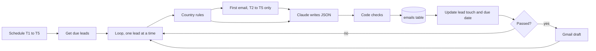
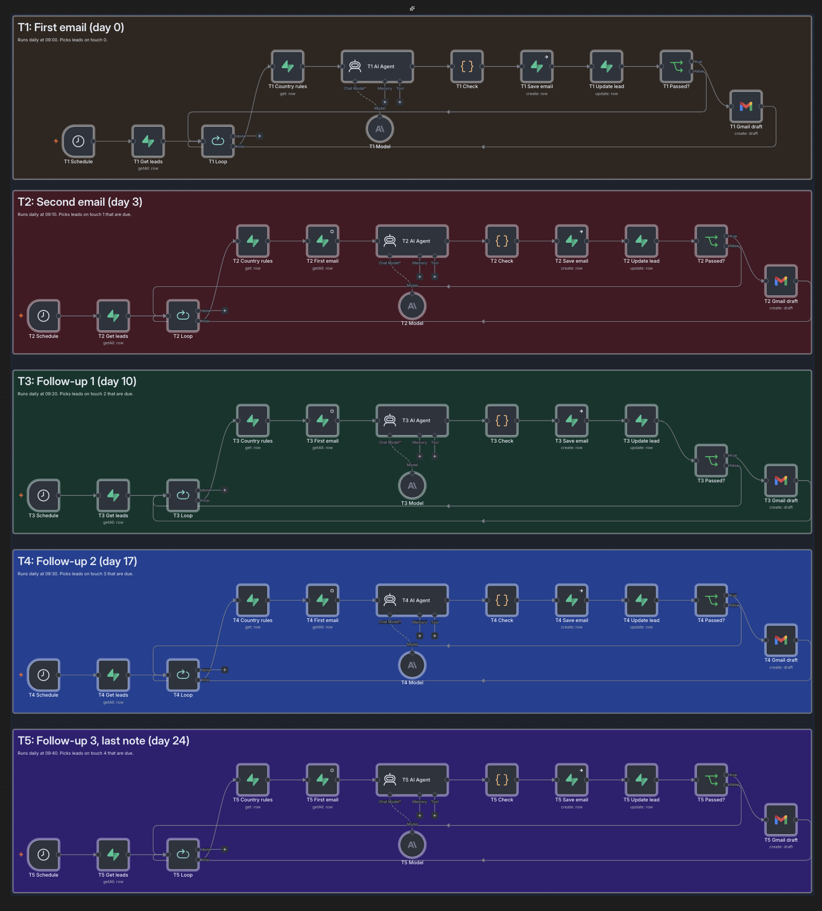

# Outbound Loop

A multi-country outbound email sequence built in n8n, Supabase and Claude. Each country has its own pitch, tone, call to action and banned claims, stored as data. The model writes every email, and code checks every email before it can become a draft.

> **Portfolio project with fictional data.** Hirevo, every company, person and reply in this repo is made up. Countries are labelled A, B, C and D on purpose. No email is sent automatically: the workflow creates Gmail drafts for a human to review.

## What it does

1. Five scheduled lanes (T1 to T5) run every morning. Each lane picks up to 5 leads that are due for its touch.
2. For each lead, the lane loads that lead's country rules from Supabase.
3. Claude writes the email from the lead data, the country rules and, for touches 2 to 5, the first email already sent.
4. A Code node runs the checks. The model never grades its own output.
5. Every result is saved to `emails`, passed or failed, with the result of each check.
6. The lead moves to the next touch and gets its next due date.
7. Only emails that pass every check become Gmail drafts.



## The sequence

| Lane | Runs daily | Picks | Email | Max words | Next due |
|---|---|---|---|---|---|
| T1 | 09:00 | `ready`, touch 0 | First email, opens with a hiring signal | per country | +3 days |
| T2 | 09:10 | touch 1, due | Second email, secondary value | 80 | +7 days |
| T3 | 09:20 | touch 2, due | Follow-up 1, how the process works | 80 | +7 days |
| T4 | 09:30 | touch 3, due | Follow-up 2, short check-in | 60 | +7 days |
| T5 | 09:40 | touch 4, due | Last note | 50 | lead set to `closed` |

Touches 2 to 5 reuse the first subject as `Re: ...`. A unique key on `(lead_id, touch)` makes a duplicate email for the same touch impossible.

### n8n workflow



## Country rules

Stored in `country_rules`, one row per country, and pulled into the prompt for every lead.

| Country | Pitch angle | Tone | Rule checked in code |
|---|---|---|---|
| A | speed to fill | warm and professional | must say timing depends on the role and market |
| B | candidate quality | direct and friendly | first two sentences must be about candidates |
| C | HR workload | polite and structured | must say the process depends on role seniority |
| D | employer brand | concise and factual | no superlatives, no salary talk |

## Checks (in code, per email)

| Check | Fails when |
|---|---|
| `valid_json` | the model did not return the agreed JSON |
| `subject_length` | subject is empty or too long |
| `word_count` | body is over the lane's limit |
| `cta_present` | the country's call to action is missing or reworded |
| `no_exact_figures` | a percentage or money figure appears |
| `no_guarantee` | "guarantee" or "risk-free" appears |
| `no_em_dash` | an em dash appears |
| `no_banned_words` | best, leading, number one, salary, perfect candidate |
| `country_rule` | the country rule above is broken (T1 to T3) |

Each result is stored in `emails.checks`, so a failed email shows exactly which rule broke. `sql/06_report_queries.sql` gives the pass rate by touch and country and the checks that fail most.

## Data model

| Table | Purpose |
|---|---|
| `country_rules` | pitch, tone, value props, banned claims, CTA, word limit per country |
| `leads` | enriched contacts, sequence status, current touch, next due date |
| `emails` | every draft and failure, with check results |
| `replies` | test replies with the expected label and action |
| `kb_chunks` | product facts for the reply agent (pgvector) |
| `run_log` | errors and heartbeat |
| `experiments` | hypothesis, volume, window and decision rule per test |

Row level security is on for every table. n8n connects with the service key.

## Setup

1. Create a Supabase project and run the files in `sql/` in number order. Replace `you+N@example.com` in `03_leads.sql` with your own test inbox first (Gmail plus addresses work).
2. In n8n, import `n8n/sequence_workflow.json`.
3. Add three credentials and select them on the nodes: Supabase (project URL and service key), Anthropic, Gmail.
4. Test one lane by hand: Execute workflow, choose `T1 Schedule`. Check the `emails` table and your Gmail drafts.
5. Activate the workflow to let the schedules run.

## Status

| Part | Status |
|---|---|
| Country rules as data | built |
| T1 to T5 sequence with code checks | built |
| Gmail drafts, human review | built |
| Reply classifier (7 labels) | planned, test replies in `data/replies.json` |
| Knowledge-base answers for questions, escalation for fees, guarantees and client names | planned, content in `data/knowledge_base.md` |
| Heartbeat and weekly report | planned |

## Repo layout

```
sql/    schema, seed data and report queries
n8n/    workflow export, credentials removed
docs/   workflow screenshot
data/   the same seed data as CSV, JSON and Markdown
```
